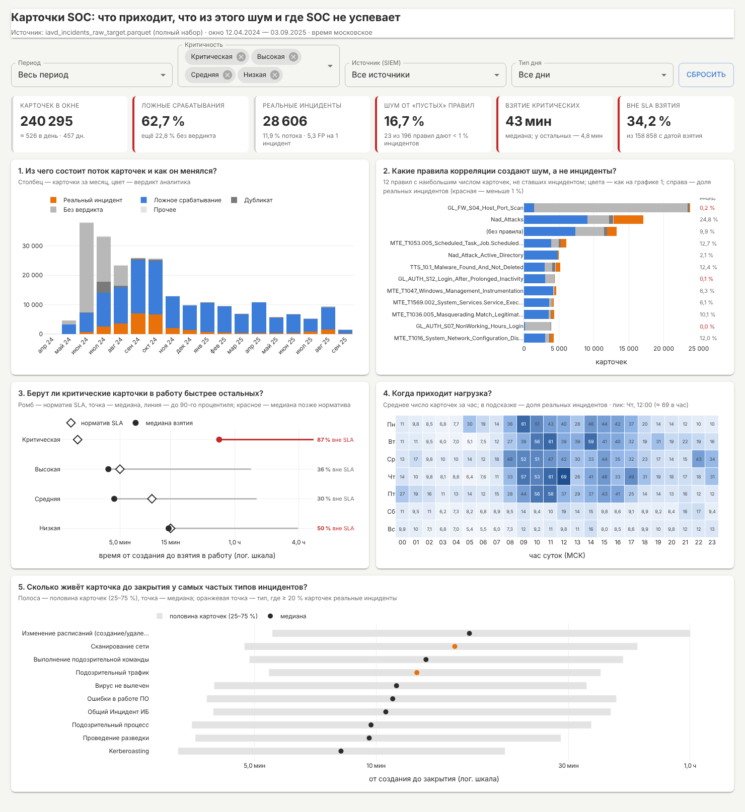

# Задание 1 · Карточки SOC

Дашборд Taipy для **руководителя SOC**: пять вопросов о потоке карточек, на каждый — один график.
Выводы с числами — в [`REPORT.md`](REPORT.md) (его собирает `report.py` из тех же функций, что и дашборд).



## Пять вопросов и почему именно этот график

| # | Вопрос руководителя SOC | График | Почему он |
|---|---|---|---|
| 1 | Из чего состоит поток карточек и как он менялся? | Столбцы с накоплением по месяцам (по неделям, если окно ≤ 120 дней), цвет — вердикт | Высота — объём, сегменты — состав, одна ось времени. Линия потеряла бы состав, круговая — динамику. |
| 2 | Какие правила корреляции создают шум, а не инциденты? | Линейчатая с накоплением: 12 правил с наибольшим числом «не инцидентов», справа — доля реальных инцидентов | Длина — самый точный канал сравнения, длинные имена правил читаются горизонтально. Красная подпись (< 1 %) — кандидат на доработку правила. |
| 3 | Берут ли критические карточки в работу быстрее остальных? | «Гантели»: норматив SLA (ромб), медиана (точка), 90-й процентиль (конец линии), лог. шкала | Норматив, типичное время и хвост на одной строке. Красная точка — медиана позже норматива. |
| 4 | Когда приходит нагрузка? | Тепловая карта «день недели × час суток», среднее число карточек за час | Две категории и одна величина. Делим на число таких дней в окне — иначе сравнение дней недели было бы нечестным. |
| 5 | Сколько живёт карточка до закрытия у самых частых типов инцидентов? | Полоса 25–75 % и медиана, лог. шкала | Разброс, а не одно число. Оранжевая точка — тип, где ≥ 20 % карточек реальные инциденты. |

**KPI-плитки** над графиками: карточек в окне, доля ложных срабатываний, реальные инциденты,
доля потока от «пустых» правил (< 1 % инцидентов), медиана взятия критических карточек, доля
нарушений SLA взятия. Красная полоса слева — показатель, на который стоит обратить внимание.

**Цвета** одинаковы во всех трёх заданиях: оранжевый — реальный инцидент, синий — ложное
срабатывание, серые — дубликаты, без вердикта и прочее, красный — только нарушения.

**Фильтры** действуют на все плитки и графики сразу: период (весь, последние 180 / 90 / 30 дней
до последней даты в данных), критичность (несколько значений), источник SIEM, тип дня
(по производственному календарю). Кнопка «Сбросить» возвращает всё к исходному виду.

## Запуск

Из корня репозитория (данные — см. [`data/README.md`](../data/README.md)):

```bash
poetry run python task_1/app.py
```

Откройте http://127.0.0.1:5011. Если полного файла нет, дашборд возьмёт выборку из 1 000 карточек;
другой файл можно указать явно: `--data data/iavd_1000_incidents_raw_target.parquet`.

```bash
poetry run python task_1/report.py                 # пересобрать REPORT.md
poetry run python -m unittest discover -s task_1   # проверки расчётов (данные не нужны)
```

## Файлы

| Файл | Что внутри |
|---|---|
| `app.py` | приложение Taipy: разметка, фильтры, обработчики |
| `filters.py` | фильтры (период, критичность, источник, тип дня) без Taipy |
| `metrics.py` | расчёты для пяти вопросов, только pandas |
| `charts.py` | Plotly-фигуры |
| `views.py` | плитки и фигуры для одного набора фильтров — общая точка для дашборда и отчёта |
| `report.py` | собирает `REPORT.md` |
| `styles.css` | оформление страницы |
| `test_task1.py` | проверки на синтетических карточках |

Общий код (загрузка карточек, палитра, форматирование чисел) — в [`src/`](../src).
