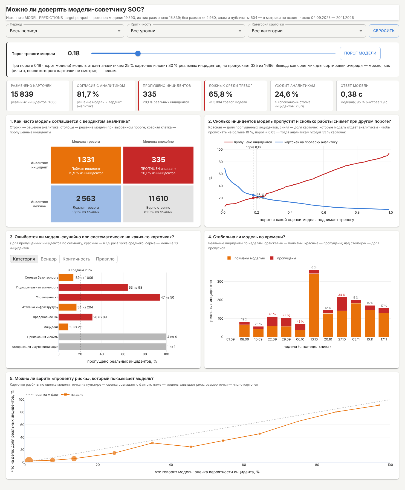

# Задание 2 · Инференс модели: можно ли ей доверять

Дашборд Taipy для **руководства SOC** — аудитории, не связанной с машинным обучением. Модель
отсортировала карточки по вероятности инцидента; дашборд показывает, где ей можно доверять, а где нет.
Главная метрика по условию — **доля пропущенных реальных инцидентов**: ей отданы красная плитка и красная
клетка матрицы. Выводы с числами — в [`REPORT.md`](REPORT.md).



## Пять вопросов и почему именно этот график

| # | Вопрос руководителя | График | Почему он |
|---|---|---|---|
| 1 | Как часто модель соглашается с вердиктом аналитика? | Матрица ошибок словами: «пойман / пропущен / ложная тревога / верно отсеяно» | Четыре клетки понятны без обучения; одна общая «точность» скрыла бы, что пропуск инцидента и ложная тревога стоят по-разному. |
| 2 | Сколько инцидентов модель пропустит и сколько работы снимет при другом пороге? | Две линии от порога: пропущенные инциденты и карточки для аналитиков | Цена решения в одном взгляде: «риск ↔ нагрузка». Ползунок над дашбордом двигает порог для всех элементов сразу. |
| 3 | Ошибается ли модель случайно или систематически? | Линейчатая: доля пропусков по сегменту; переключатель разреза — категория, вендор, критичность, правило | При случайных ошибках все столбцы стояли бы у пунктира среднего. Подпись «X из Y» показывает, на скольких инцидентах основан вывод; серые — меньше 10 инцидентов. |
| 4 | Стабильна ли модель во времени? | Столбцы с накоплением по неделям: пойманные и пропущенные инциденты, над столбцом — доля пропусков | Объём и качество на одной шкале, без второй оси. |
| 5 | Можно ли верить «проценту риска», который показывает модель? | Калибровочная кривая: оценка модели против реальной доли инцидентов | Руководителю показывают «риск 70 %» — график отвечает, сколько за этим стоит на деле. |

**Ползунок порога** — главный интерактивный элемент: решение модели пересчитывается из её оценки
(`y_pred_proba ≥ порог`), и вместе с ним меняются плитки, матрица, сегменты и недельный график.
Кнопка «Порог модели» возвращает исходные 0,18 (в `model_params` записан порог 0,82 для класса «FP»).

**KPI-плитки:** размечено карточек, согласие с аналитиком, пропущено инцидентов, доля ложных среди
тревог, доля карточек, которые уходят аналитикам (и доля инцидентов в «спокойной» стопке), задержка ответа модели.

**Фильтры:** период (весь / последние 30 / 14 дней), критичность, категория карточки.

## Запуск

```bash
poetry run python task_2/app.py                    # http://127.0.0.1:5012
poetry run python task_2/report.py                 # пересобрать REPORT.md
poetry run python -m unittest discover -s task_2   # проверки расчётов (данные не нужны)
```

Нужен `data/MODEL_PREDICTIONS_target.parquet` (см. [`data/README.md`](../data/README.md)).

## Файлы

| Файл | Что внутри |
|---|---|
| `app.py` | приложение Taipy: разметка, ползунок порога, фильтры, переключатель разреза |
| `data.py` | чтение лога, только размеченные карточки, разбор JSON-полей, решение при пороге |
| `filters.py` | фильтры без Taipy |
| `metrics.py` | матрица ошибок, кривая порога, сегменты, недели, калибровка |
| `charts.py` | Plotly-фигуры |
| `views.py` | плитки и фигуры для набора фильтров (общие для дашборда и отчёта) |
| `report.py` | собирает `REPORT.md` |
| `test_task2.py` | проверки на синтетическом логе |

## Решения по данным

- В метрики входят только размеченные прогоны (`y` = 1 — инцидент, `y` = 0 — ложное срабатывание).
  Без разметки (2 950) и спам/дубликаты (604) исключены — иначе precision и recall были бы искажены.
- Решение модели при пороге 0,18 совпадает с полем `y_pred` для всех размеченных карточек (проверено).
- Поля карточки (`Правило корреляции SIEM` и др.) — JSON-массивы; для разрезов берётся первый элемент.
- «Ненадёжные» сегменты (меньше 10 реальных инцидентов) показаны серым и не участвуют в выводах.
